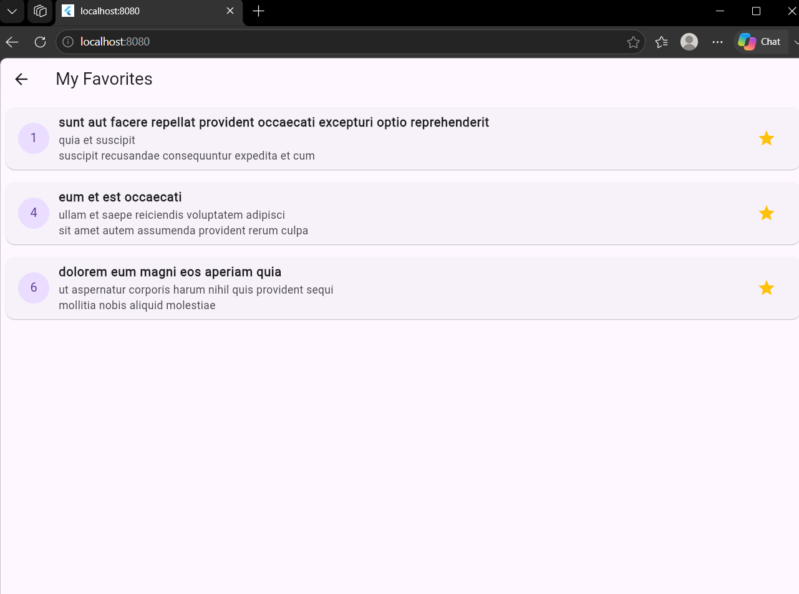
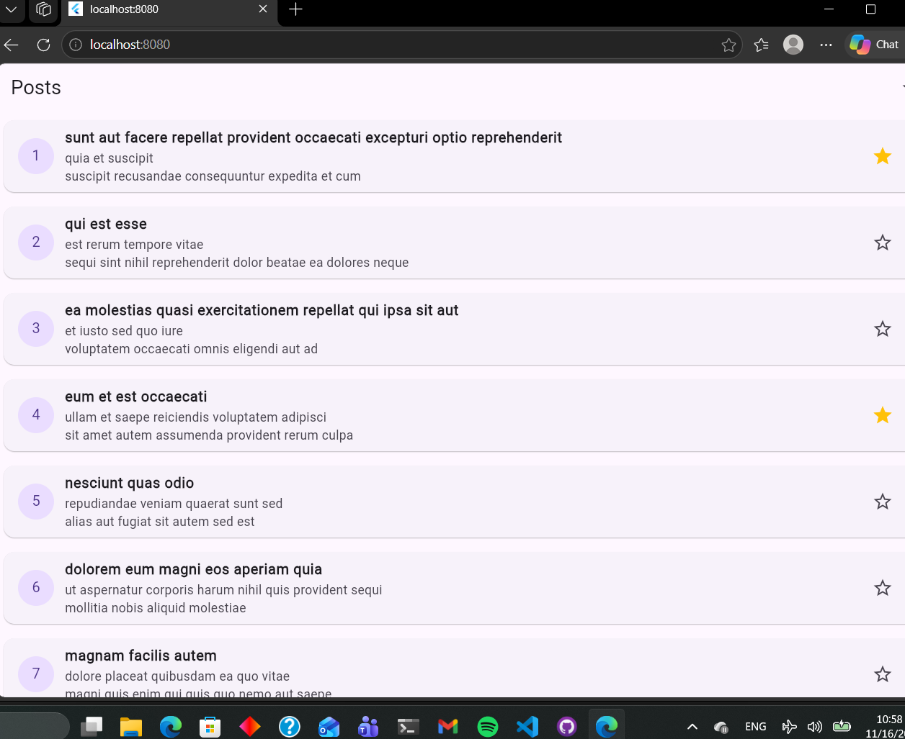

# Flutter Posts App – Offline Caching & Favorites

## Project Description
This project is a Flutter mobile application that retrieves posts from the JSONPlaceholder API and allows users to save their favorite posts locally.

The application uses Hive for local storage, allowing previously loaded posts and saved favorites to remain available even when the device is offline.

## Features
- Fetch posts from the JSONPlaceholder API.
- Display posts with their titles and descriptions.
- Save and remove favorite posts.
- View all saved favorites on a separate screen.
- Store posts locally using Hive.
- Load cached posts when there is no internet connection.
- Preserve favorites after closing and reopening the application.
- Display a friendly message when the favorites list is empty.

## Technologies Used
- Flutter
- Dart
- Hive
- Hive Flutter
- HTTP package
- JSONPlaceholder API

## API
https://jsonplaceholder.typicode.com/posts

## Project Structure
```text
lib/
├── main.dart
├── models/
│   ├── post_model.dart
│   └── post_model.g.dart
├── services/
│   ├── post_service.dart
│   └── favorites_service.dart
└── screens/
    ├── posts_screen.dart
    └── favorites_screen.dart
```

## Installation and Setup

1. Clone this repository:
   ```bash
   git clone https://github.com/nour-essam04/flutter-post-favorites.git
   ```

2. Open the project folder:
   ```bash
   cd assignment3
   ```

3. Install dependencies:
   ```bash
   flutter pub get
   ```

4. Run the application:
   ```bash
   flutter run
   ```

## Offline Functionality
The application uses Hive to store posts and favorites locally.

When an internet connection is unavailable:
- Previously cached posts can still be displayed.
- Saved favorite posts remain accessible.
- Favorites persist after restarting the application.


## Screenshots

### Posts Screen


### Favorites Screen



### Offline Mode


## Author
Student Name: Nour Essam

Course: Mobile Computing

Academic Year: 2026–2027
